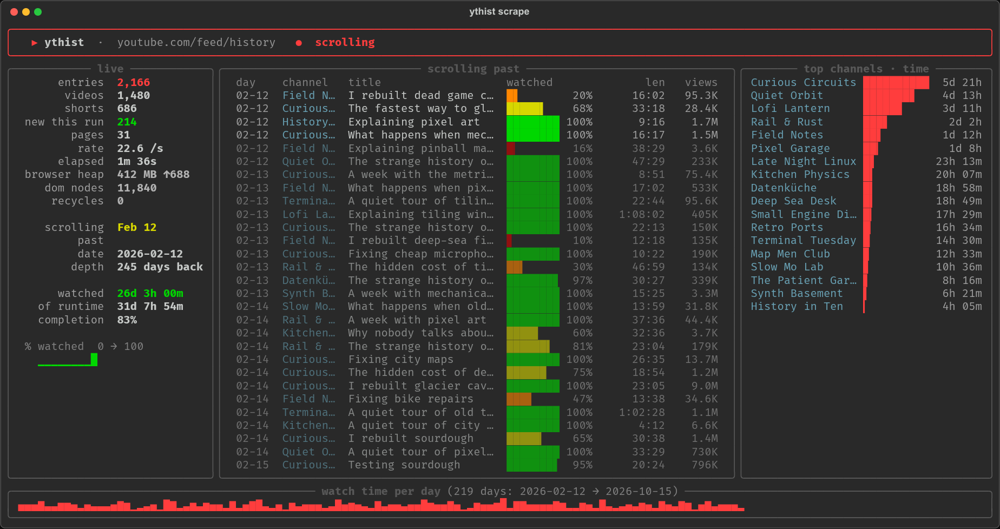
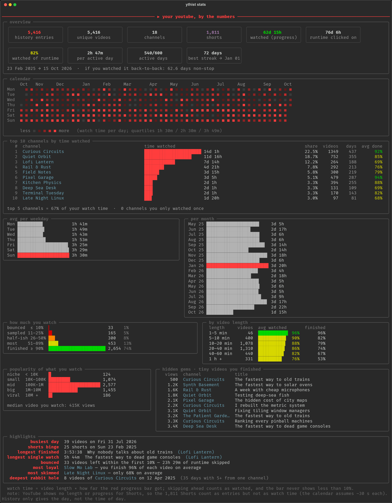

# ythist

Scroll through your entire YouTube watch history, keep every entry in a local SQLite database,
and get a terminal report on what you actually watch.



`ythist` opens [youtube.com/feed/history](https://www.youtube.com/feed/history) in a real browser,
pages down until the end, and reads YouTube's own JSON as it loads — so it gets the channel,
title, view count, video length and **how far you watched each video** (the red progress bar),
not just a list of links.

## Install

Needs Python ≥ 3.13 and a Chromium-based browser (Brave, Chromium or Chrome — no Playwright
browser download needed).

```sh
uv tool install git+https://github.com/omeg4-dev/yt-history
```

## Use

```sh
ythist                       # scrape → fill in Shorts channels → print the report
ythist stats                 # report only   (--since 2025-01-01, --top 25)
ythist export -f csv         # or -f json, -o file
```

The first run opens a browser window with its own profile (`~/.local/share/ythist/profile`);
log into YouTube there once and it stays logged in. Your normal browser profile and its cookies
are never touched.

Useful scrape flags:

| flag | what it does |
| --- | --- |
| `--delay MS` | time between PageDown presses (default 180) |
| `--max-pages N` | stop after N feed pages (~200 entries each) |
| `--heap-limit MB` | reload & resume when the tab's JS heap passes this (default 1200) |
| `--images` | load thumbnails — prettier, much more RAM |
| `--keep-open` | leave the browser running afterwards |
| `--no-enrich`, `--no-stats` | skip the oEmbed step / the report |

## The report



Overview tiles, a GitHub-style calendar, top channels by time, weekday and monthly rhythm, how
much of each video you finish (overall and by video length), how popular the stuff you watch is,
"hidden gems" (tiny videos you watched to the end) and highlights like your busiest day,
longest rabbit hole and most rewatched video.

*Screenshots are generated from fake data by [`scripts/screenshots.py`](scripts/screenshots.py).*

## Data

Everything lives in `~/.local/share/ythist/history.db`. The `history` view is the easy way in:

```sh
sqlite3 ~/.local/share/ythist/history.db \
  "select watch_date, channel_name, title, percent, watched_s from history limit 10"
```

| column | |
| --- | --- |
| `watch_date`, `date_label` | day it appears under, resolved from "Today" / "Monday" / "Sep 3" headers |
| `video_id`, `url`, `title`, `is_short` | |
| `channel_name`, `channel_handle`, `channel_id` | Shorts get their channel via YouTube's public oEmbed |
| `views`, `duration_s` | |
| `percent`, `watched_s` | red progress bar, and length × progress |
| `position` | 0 = most recent |

Each run merges into the database (one row per video per day), so scraping again only adds.
The raw JSON pages of every run are kept gzipped under `~/.local/share/ythist/raw/` along with a
`scrape.log`.

## Long histories

A full scroll of ~46k entries takes about 8 minutes. To keep the browser from running out of
memory on the way:

- thumbnails, avatars, hover previews and fonts are blocked at the network level;
- day sections far above the viewport are removed from the DOM and emptied in YouTube's data model;
- when the tab's heap (after a forced GC) still passes `--heap-limit`, the page is reloaded and
  YouTube's first "load more" request is pointed at the saved continuation token, so it picks up
  exactly where it left off. On a 46k-entry history this keeps the tab at ~1.3 GB instead of ~3 GB.

## Caveats

- **Watch time is an estimate**: length × the progress bar. Skipping ahead counts as watched and
  the bar never shows less than 10 %.
- **Shorts** have no length or progress in the history feed, so they count as entries, not time.
- Videos over **12 h** (24/7 streams, stream archives) get no watch time — their "duration" says
  nothing about how long you watched.
- History only gives the **day**, not the time of day.
- YouTube's pagination and Shorts shelves vary a little between loads (~2 % of Shorts); repeated
  runs fill in the gaps.
- Relies on YouTube's internal page structure, which changes now and then.
